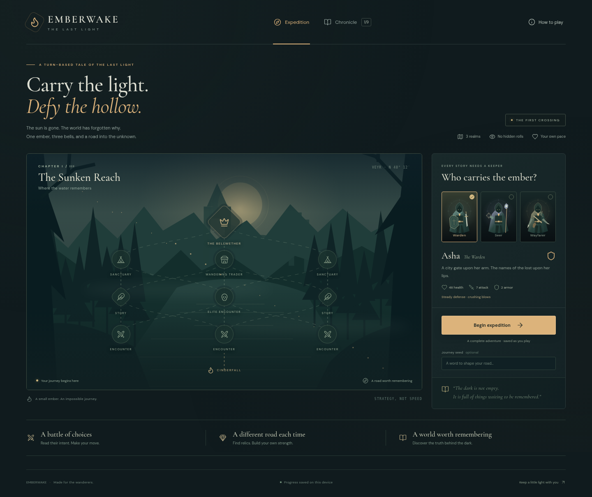

# Emberwake · The Last Light

A browser fantasy adventure about the things worth remembering. Carry a stolen ember through three fallen realms, awaken their bells, and choose what becomes of a world without a sun.

**Play at your own pace.** Every battle is turn based, every enemy intention is visible, and every move is saved on your device. No account, server, paid mechanics, or external runtime services.



## Play and develop

Requires **Node.js 22 or newer** and npm.

```sh
npm ci
npm run dev
```

In the managed cloud environment, use `npm ci --cache /workspace/.npm-cache` because the home directory may be read-only. The development server binds to all interfaces on port 5173 by default. Use the existing checkout; a new worktree is unnecessary.

```sh
npm test                 # Combat, economy, progression, save validation, full campaigns
npm run build           # Strict TypeScript check and production assets
npm run test:e2e         # Real Chromium gameplay, accessibility, save/resume, mobile
npm run check            # All of the above
npm run format:check     # Formatting
```

Browser tests use `/usr/bin/chromium` when present. On other machines, run `npx playwright install chromium` first. CI installs its browser and OS dependencies automatically. To inspect failures, use the screenshots and traces in `test-results/`.

`npm run build` produces `dist/`, which can be hosted by any static web host. `npm run preview` serves that build for local testing. No environment variables or credentials are required to run the game.

## The first crossing

- **Three keepers:** Asha the Warden, Orin the Seer, Sable the Wayfarer.
- **Three realms:** the Sunken Reach, the Glass March, the Rootbound Crown.
- **Twelve encounters:** connected routes, story decisions, sanctuaries, traders, elites, and three bosses.
- **Six unique relics** that change combat strategy, plus permanent upgrades within a run.
- **Two complete endings** and a persistent nine-entry chronicle.
- **Reproducible journeys:** enter the same seed word for the same route, events, and relic offers.
- **Local autosave:** reload to resume the exact turn. Browser storage failures are reported without preventing play.
- Responsive layouts, keyboard controls, reduced-motion support, native accessible dialogs, and locally bundled fonts and original SVG artwork.

In combat, use the action buttons or keys **1–4**. Your action resolves first, then poison, then the enemy's visible intention. **Guard lasts one enemy action. Flasks also end your turn.** Open “How to play” for the complete introduction.

## Design and implementation

The [lore](docs/LORE.md) was established before implementation. The [rules](docs/RULES.md) define the mechanical contract. The UI calls a pure, deterministic state engine; it does not calculate a second version of the combat rules.

| Location                  | Purpose                                             |
| ------------------------- | --------------------------------------------------- |
| `src/game/data.ts`        | Keepers, scenes, relics, lore, and chapter content  |
| `src/game/engine.ts`      | Seeded routes and pure rule transitions             |
| `src/game/storage.ts`     | Versioned save validation and profile progression   |
| `src/App.tsx`             | Campaign screens, local persistence, navigation     |
| `src/components/`         | Original illustrations, route graph, icons, dialogs |
| `src/game/engine.test.ts` | Rules and complete campaign tests                   |
| `tests/`                  | Real-browser tests and a bounded test-player search |

The save format is version 1 under `emberwake.save.v1`. Saves are local and editable; this is a single-player game, not a trusted competitive leaderboard. Profiles retain discovered memories and completed-run counts. Relics, attack upgrades, and supplies reset each run.

## Continuing development

See [HANDOVER.md](HANDOVER.md) for the latest checkpoint, validation evidence, known limits, and a continuation prompt. See [the roadmap](docs/ROADMAP.md) for next priorities.

Fonts are bundled from Fontsource under their SIL Open Font License. Interface icons are Lucide (ISC). Landscape, keeper, and enemy illustrations are original SVG components. Third-party license details remain in their npm packages.
