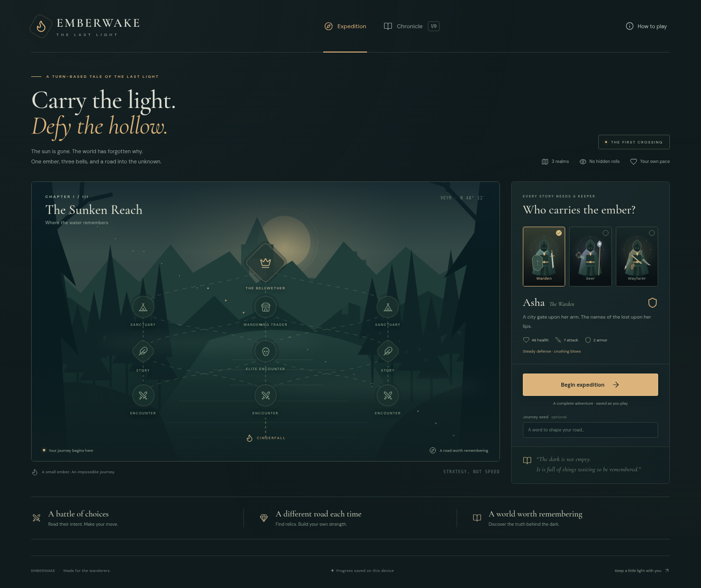

# Emberwake · The Last Light

A browser fantasy adventure about the things worth remembering. Carry a stolen ember through three fallen realms, awaken their bells, and choose what becomes of a world without a sun.

**Play at your own pace.** Every battle is turn based, every enemy intention is visible, and every move is saved on your device. No paid mechanics. Regional chart preparation uses OpenStreetMap services; play then uses the saved chart. The private hosted version requires your ChatGPT sign-in.



## Play and develop

Requires **Node.js 22 or newer** and npm.

```sh
npm ci
npm run dev
```

In the managed cloud environment, use `npm ci --cache /workspace/.npm-cache` because the home directory may be read-only. The development server binds to all interfaces on port 5173 by default. Use the existing checkout; a new worktree is unnecessary.

```sh
npm test                 # Combat, economy, progression, save validation, full campaigns
npm run build           # Strict TypeScript check and production assets
npm run test:e2e         # Real Chromium gameplay, accessibility, save/resume, mobile
npm run check            # All of the above
npm run format:check     # Formatting
npm run balance          # Optional 90-campaign strategic-route regression matrix
```

Browser tests use `/usr/bin/chromium` when present. On other machines, run `npx playwright install chromium` first. CI installs its browser and OS dependencies automatically. To inspect failures, use the screenshots and traces in `test-results/`.

`npm run build` produces the game assets and a self-contained Worker at `dist/server/index.js`. Regional map creation needs this Worker (or the API integrated into `npm run dev`); a static host or `npm run preview` supports the original campaigns and already saved charts. The default provider needs no API key.

## The first crossing

- **Three keepers:** Asha the Warden, Orin the Seer, Sable the Wayfarer.
- **Three realms:** the Sunken Reach, the Glass March, the Rootbound Crown.
- **Twelve encounters:** connected routes, story decisions, sanctuaries, traders, elites, and three bosses.
- **Six unique relics** that change combat strategy, plus permanent upgrades within a run.
- **Two complete endings** and a persistent nine-entry chronicle.
- **Reproducible journeys:** enter the same seed word for the same route, events, and relic offers.
- **Local autosave:** reload to resume the exact turn. Browser storage failures are reported without preventing play.
- **Portable journals:** export or restore a validated save file to carry the expedition between browsers. Open “Journal” in the header or footer; files stay on your device.
- Responsive layouts, keyboard controls, reduced-motion support, native accessible dialogs, and locally bundled fonts, original painted landscapes and character portraits.

The list above describes the first two rulesets. In combat your action resolves first, then poison, then the enemy's visible intention. **Guard lasts one enemy action. Flasks also end your turn.** Open “How to play” for the complete introduction.

## The Hearth-wagon and the Provinces · v0.9

- **A camp that is a town.** On the Lost Atlas your camp is a hearth-wagon. Each evening build one of six works onto it (a stove, a dew-still, a whetwheel, a lamp-rack, a toll-box, a ward-lantern) or rest by its fire — never both. Works pay at dawn; nights still cost.
- **A map of the realm.** Choose where the veil falls on a real map of Slovakia, drawn as eight provinces of Veyr that mirror the eight kraje. A province campaign reaches both of its hidden cities; rekindle both to recover the province's legend.
- **Voices.** Guardians and elites speak. Each keeper writes their own page after every bell and lives their own epilogue under each ending: fifteen new chronicle pages, and three tellings of one story.
- [The backlog](docs/BACKLOG.md) lists what comes next, sized for different agents. [Art brief 2](docs/ART_BRIEF_2.md) asks for the wagon works, province crests and four paintings.

## The Living Map · v0.8

The Lost Atlas becomes an adventure map with a clock, and the map becomes a tool.

- **Days and lamp oil.** A keeper walks a fixed distance of real road per day. Make camp for a new day: freed waylights pay at dawn, and the dark gathers a little each night.
- **Wayside finds** lie on the roads themselves, so a detour is a decision.
- **A route planner.** Select any charted landmark to see the shortest known route, its distance and walking time and whether today's oil reaches it; one button walks it.
- **Trail blazes** on walked roads, kilometres and minutes instead of paces, links to OpenStreetMap and Mapy.com once a city is named.
- **The atlas passport** in the Chronicle stamps every real place you chart, complete and name.
- **Clarity:** tap any status chip for its meaning, action titles show the true damage, a victory beat before the spoils.
- **Illustrations on demand.** Enemy portraits, relic icons, map pictograms and scene paintings are picked up from `src/art/` when present and fall back to the built-in graphics when not. [The art brief](docs/ART_BRIEF.md) specifies every file.

See [the round-two plan](docs/ROUND2_PLAN.md).

## The Long Night · v0.7

New expeditions use a third ruleset built so that every turn asks a question and every run is different. Earlier journals continue under their own rules.

- **Poise and stagger.** Every enemy has a poise bar. Hits wear it down; break it and the enemy loses the action it had announced and takes +50% damage until it acts again. A **perfect guard** — absorbing a whole attack — wears poise by the damage blocked.
- **Five actions.** Each keeper gains a second technique: Shield bash, Foresee, Quicken.
- **Exact previews.** Under every action is what it will do this turn, computed by the engine itself. The next two enemy intentions are always shown.
- **A bestiary of 21** with their own patterns and traits (thorns, plating, regrowth, fury, frost, weakness, multi-hit); guardians change pattern at half health.
- **28 relics in three rarities**, three offered after each victory and three more at every trader.
- **Seeded routes and twelve story scenes**: the middle of every realm is arranged by the seed.
- **Reasons to return:** a transparent score, eight **Dusk** levels unlocked one win at a time, 22 **deeds** (twelve add a relic to future roads), a codex of relics, enemies and past roads, and an optional date-seeded **today’s road**. Nothing raises a keeper’s starting strength.
- One-screen combat on laptops and phones, hit feedback, first-fight guidance, and opt-in synthesized sound (off by default).

Keyboard in combat: **1** Strike · **2** Guard · **3** Skill · **4** Technique · **5** Flask. See [the plan and diagnosis](docs/IMPROVEMENT_PLAN.md), [the rules](docs/RULES.md) and [the balance matrix](docs/BALANCE_REPORT.json).

## Maps ready to play · v0.6

**The Lost Atlas → Bundled maps** starts with no map-provider connection. Choose Slovakia or any of its eight kraje; 16 historical city road charts are included, two per kraj. A seed chooses the hidden city inside that area. Setup shows coverage counts without revealing the city. Live map remains available and falls back to this collection inside the same chosen area if the provider fails. Other countries need the live provider until their own collections are added.

These are road snapshots published in 2022 or earlier, not current maps or complete terrain datasets. The complete chart stays in your autosave and exported journal. The game site still needs to load normally; no external map service is used for bundled play. See [collection design](docs/BUNDLED_ATLAS.md) and [geographic sources/downloads](public/atlas/NOTICE.md).

## The illuminated atlas · v0.5

A complete interface redesign gives Emberwake the feel of an illustrated field atlas: forest-green ink, warm parchment, antique copper and generous serif typography. Original paintings depict the three realms, all three keepers and four adversary identities. Artwork and fonts are bundled locally.

The opening leads into a numbered expedition builder with both journey types, regional setup, keeper portraits and the optional seed. Active expeditions use a compact context header, a larger encounter/map area and a keeper panel; on phones the keeper's health and supplies stay above the board while you scroll. The Atlas objective appears before the chart. Combat separates the arena, exact enemy intent and four action cards. Rewards, lessons, stories, traders, sanctuaries, the Chronicle and journal dialogs share the new visual system.

All rules, map features, regional choices, keyboard controls and existing journals are preserved. See [the redesign plan and verification](docs/UI_REDESIGN.md).

## Choose your country or region · v0.4

Select **The Lost Atlas → Live map**, enter your area, then **Begin expedition**. Bundled maps are now the default for reliable Slovak play. Slovakia is the default. Expand the quick choices for **Bratislavský, Trnavský, Trenčiansky, Nitriansky, Žilinský, Banskobystrický, Prešovský or Košický kraj**; accented and unaccented Slovak names and ISO codes work. You can also enter another country's or administrative region's local/English name. Ambiguous areas require an ISO code; unsupported areas show an error instead of choosing somewhere else.

The game resolves the real administrative boundary, selects a city/town **inside that area**, and builds an expedition over its connected OSM streets. Your region remains visible as a clue; the city stays hidden. Correctly guessing the **city**, including supported alternative names, earns the existing recognition bonus. Naming the country/region does not count.

New regional charts need an internet connection while being prepared, usually several provider requests. The private Site proxies and caches these Overpass requests; no Nominatim or tile API is used. Provider availability, OSM coverage, connected road density and coastline complexity affect which charts can be generated. The service tries at most two city extracts per deliberate request. Retry with a different seed if a map cannot be compiled. Worldwide region lookup is supported by the pipeline, with Slovakia as the first focused test; this is not a guarantee for every administrative boundary or city worldwide.

The complete generated map travels with your autosave and exported journal, so exploration and reload do not need provider calls or silently change the chosen city. Journal import is now capped at **2 MB** to carry geometry, while all previous journals remain accepted. **Original offline chart** keeps the original bundled Saltbound Coast available without map downloads.

`npm run build` now builds and validates a standalone Worker serving the game assets and `/api/atlas`. The existing owner-only Site identity is preserved; `.openai/hosting.json` omits `static` for this Worker deployment. `OVERPASS_URL` may select a compatible provisioned Overpass endpoint without changing the game. See [the regional design](docs/REGIONAL_ATLAS.md).

## The original Lost Atlas · v0.3

Select **The Lost Atlas** above the keeper choices, then **Begin expedition**. Existing journeys resume as before; use **Leave this expedition** and confirm if you want to start the new mode instead. Export your current Journal first to keep both journeys.

The Saltbound Coast is a complete new expedition on a real OpenStreetMap region, rendered as a forgotten fantasy realm. Walk the connected roads to uncover the terrain. Reach and resolve twelve encounters, awaken three bells, and collect optional supplies on side paths. Your road history and uncovered chart save with the expedition. Previously explored terrain stays visible; walking back does not generate income.

Shorelines, harbours, old streets and gardens preserve their real shapes, but every landmark has a fantasy identity. Field notes offer clues. If you recognize the place beneath the veil, name it in the journal: a correct answer grants +2 attack once and charts a hidden hearth. There is one attempt per bell stage, no damage for a wrong answer, and the full campaign is winnable without recognition. The haven can also be found by exploring.

The map has a keeper zoom and a whole-chart view. Direction/distance road buttons and a landmark index support keyboard and mobile play. All terrain is bundled: no tile API, GPS permission, external map requests or API key is needed during play. See [the concept and implementation plan](docs/LOST_ATLAS.md) for research and future charts. The original chart is deliberately curated. The v0.4 regional generator described above adds other geographies.

Geographic data: © [OpenStreetMap contributors](https://www.openstreetmap.org/copyright), [ODbL 1.0](https://opendatacommons.org/licenses/odbl/1-0/). The downloadable [geographic database, source and provenance](public/atlas/NOTICE.md) are distributed separately from the original fiction and game code. The chart uses a historical snapshot, not current navigation data. Rebuild deterministically with `python3 scripts/build-atlas.py public/atlas/source.osm.gz`.

## Roads Rekindled · v0.2

- **A road that gives back:** free a Dawnwell, Cinder Kiln, or Moth Observatory in each realm. Choose future health, expedition income, or opening focus. Sites stack within a run and only pay when you cross into another encounter.
- **Nine remembered lessons:** after the first two bells, choose one of your keeper's unlearned specializations. Build around defense, focus, burst damage, venom, or shared supplies.
- **Free scouting:** inspect any map node before committing. Read its complete enemy pattern, rewards, and waylight benefit; future nodes can be inspected but cannot skip the route.
- **Different threats:** kiln guardians attack continuously, observatory guardians drain focus, and elites pressure your preparation.
- **Existing journals preserved:** old expeditions resume with their original rules and exact turn, while new expeditions use the expanded ruleset.

[Design research](docs/DESIGN_RESEARCH.md) records the Heroes III/VCMI references and independent design decisions behind this milestone. The [90-campaign report](docs/BALANCE_REPORT.json) covers both rulesets, all keepers, and three strategic route plans. Its automated search establishes reachable winning paths; human playtesting is still needed for difficulty and enjoyment.

## Design and implementation

The [lore](docs/LORE.md) was established before implementation. The [rules](docs/RULES.md) define the mechanical contract. The UI calls a pure, deterministic state engine; it does not calculate a second version of the combat rules.

| Location                  | Purpose                                             |
| ------------------------- | --------------------------------------------------- |
| `src/game/data.ts`        | Keepers, scenes, relics, lore, and chapter content  |
| `src/game/engine.ts`      | Seeded routes and pure rule transitions             |
| `src/game/storage.ts`     | Versioned save validation and profile progression   |
| `src/App.tsx`             | Campaign screens, local persistence, navigation     |
| `src/components/`         | Original illustrations, route graph, icons, dialogs |
| `src/game/engine.test.ts` | Rules and complete campaign tests                   |
| `tests/`                  | Real-browser tests and a bounded test-player search |

The save format is version 2 under `emberwake.save.v2`. Version 1 saves are migrated without overwriting the original storage slot. A campaign's ruleset remains stable after migration. Saves are local and editable; this is a single-player game, not a trusted competitive leaderboard. Profiles retain discovered memories and completed-run counts. Relics, lessons, waylights, attack upgrades, and supplies reset each run.

## Continuing development

See [HANDOVER.md](HANDOVER.md) for the latest checkpoint, validation evidence, known limits, and a continuation prompt. See [the roadmap](docs/ROADMAP.md) for next priorities.

Fonts are bundled from Fontsource under their SIL Open Font License. Interface icons are Lucide (ISC). Landscape, keeper, and enemy illustrations are original SVG components. Third-party license details remain in their npm packages.
